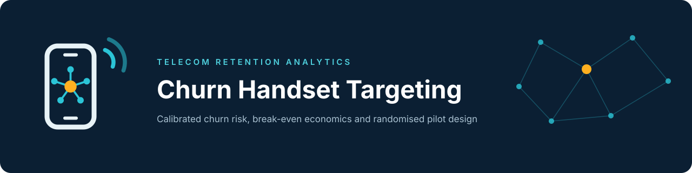
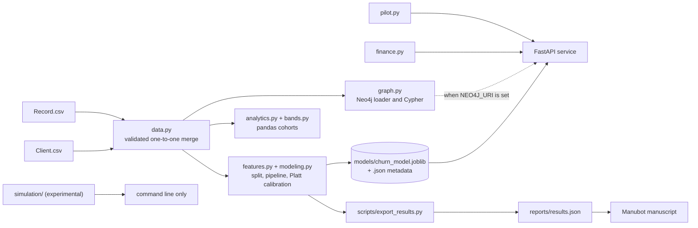

<p align="center">
  
</p>

<p align="center">
  <strong>Calibrated churn risk, break-even retention economics and randomised pilot design for a telecom operator.</strong>
</p>

<p align="center">
  <a href="https://github.com/sunilnarayan419-ui/churn-handset-targeting/actions/workflows/ci.yml"></a>
  <a href="https://github.com/sunilnarayan419-ui/churn-handset-targeting/actions/workflows/docs.yml"></a>
  <a href="https://github.com/sunilnarayan419-ui/churn-handset-targeting"></a>
  <a href="https://github.com/sunilnarayan419-ui/churn-handset-targeting/network/members"></a>
  <a href="LICENSE"></a>
</p>

<p align="center">
  
  
  
  
  
  
  
  
</p>

<p align="center">
  <a href="#overview">Overview</a> ·
  <a href="#architecture">Architecture</a> ·
  <a href="#installation">Installation</a> ·
  <a href="#api-overview">API</a> ·
  <a href="#documentation">Documentation</a> ·
  <a href="#scientific-limitations">Limitations</a> ·
  <a href="#citation">Citation</a>
</p>

---

## Overview

A telecom operator (anonymised as **Company A**) wants to reduce churn by contacting customers whose handsets
are ageing. This repository packages that analysis as tested software and a documentation set. It answers, in
order: who is at risk, whether the probabilities can be used on a realistic base rate, what a retention contact
must achieve to pay for itself, and how to measure whether it works.

> **Decision in one sentence:** use the model to design a capped, randomised retention experiment, not to
> justify an immediate roll-out. Predictive association does not establish that contacting a customer
> prevents churn.

Built from the **GCI World 2026 final assignment**. The supplied customer data are not distributed.

## Problem statement

Retention contact is cheap per customer but capacity-limited. The operator must choose whom to contact and
know the save rate at which a campaign breaks even. The data are an enriched sample (about 49.6 % churn)
while the business scenario assumes roughly 1 % monthly churn, so ranking quality, probability calibration and
causal effectiveness are treated as three separate questions
([problem statement](docs/getting-started/problem-statement.md)).

## Scientific and engineering objectives

- Validate the data and prevent leakage: keys, one-to-one merge, fit-after-split, out-of-fold calibration.
- Rank customers with a calibrated gradient-boosting model and report discrimination honestly.
- Make economics transparent: every assumption is an explicit, labelled argument.
- Size a two-arm randomised pilot, the only design that can estimate incremental retention.
- Expose the logic through a typed API, a CLI and an optional cohort graph, with reproducible reporting.

## Key capabilities

| Capability | Status |
|---|---|
| Data validation, feature pipeline, training, Platt calibration, base-rate adjustment, scoring | Implemented |
| Top-k targeting statistics, break-even economics, annualised scenarios, pilot sample size | Implemented |
| FastAPI service with seven routes and optional `X-API-Key` | Implemented |
| Neo4j cohort analytics (parity-tested against pandas) | Implemented, optional |
| Assumption-based scenario comparison with provenance manifests | Implemented, experimental |
| MiroFish agent-simulation adapter | Experimental, gated; no verified end-to-end run recorded |
| Randomised retention pilot | Proposed; not run |

## Architecture



More diagrams: [system architecture](docs/architecture/system-architecture.md),
[model pipeline](docs/architecture/model-pipeline.md), [data flow](docs/architecture/data-flow.md).

## Technology stack

| Layer | Tooling |
|---|---|
| Modelling | Python 3.10-3.12, pandas, scikit-learn (`HistGradientBoostingClassifier`, Platt calibration) |
| Service | FastAPI, Pydantic v2, Uvicorn |
| Graph (optional) | Neo4j 5 and the Python driver |
| Simulation (experimental) | YAML scenarios, MiroFish client and adapter |
| Quality | pytest, Ruff, GitHub Actions, Docker |
| Research output | Manubot manuscript, notebook, PDF/PPTX reports |
| Documentation | Sphinx, Furo, MyST Parser, autodoc, Mermaid, MathJax; uv; Read the Docs configuration |

## Machine-learning methodology

Stratified 80/20 split (seed 42); all encoding inside a scikit-learn pipeline fitted on training data;
`HistGradientBoostingClassifier` with native missing-value handling; `Customer_ID` and `ethnic` excluded
(97 features remain). Reported test ROC-AUC is 0.693 (95 % bootstrap interval 0.687-0.701), PR-AUC 0.681; top
5 % by risk gives 5.3× lift **under an assumed 1 % base rate**. Details and caveats:
[model development](docs/data-science/model-development.md), [evaluation](docs/data-science/evaluation.md),
[model card](docs/scientific-reproducibility/model-card.md).

## Calibration and base-rate adjustment

Platt scaling is fitted on out-of-fold training predictions. Probabilities are then shifted from the sample
base rate $\pi_s$ to an assumed monthly rate $\pi$ (default 0.0099) through the odds:

```text
logit(p_pi) = logit(p_cal) + ln(pi / (1 - pi)) - ln(pi_s / (1 - pi_s))
```

The 1 % rate is an assumption, not a measured Company A rate
([calibration](docs/data-science/calibration.md)).

## Retention economics

For `N` contacted customers with churn probability `p`, incremental save rate `s`, monthly revenue `r`, margin
`m`, `T` months, contact cost `c`, acceptance `a` and incentive `I`:

```text
net_variable_benefit = N * p * s * r * m * T  -  N * (c + a * I)
break_even_save_rate = (c + a * I) / (p * r * m * T)
```

Reported break-even for the top 5 % slice: 6.4 % for a $0.75 contact; 32 % when a $20 incentive accepted by
15 % of contacts is added. The save rate is an input the model cannot estimate
([retention economics](docs/business-methodology/retention-economics.md),
[break-even analysis](docs/business-methodology/break-even-analysis.md)).

## Randomised pilot design

Two equal arms, two-sided test of proportions at level α with power 1-β; with `p1 = p0 (1 - r)`:

```text
n_per_arm = ceil( (z(1-α/2) * sqrt(2 p̄ (1-p̄)) + z(1-β) * sqrt(p0 (1-p0) + p1 (1-p1)))^2 / (p0 - p1)^2 )
```

The calculation is implemented; the pilot is not run ([pilot design](docs/business-methodology/pilot-design.md)).

## API overview

| Method and path | Purpose | Model required |
|---|---|:-:|
| `GET /health` | Liveness, model and graph status (always open) | no |
| `GET /model` | Model metadata and test metrics | yes |
| `POST /score` | Score one customer | yes |
| `POST /score/batch` | Score 1-5,000 customers | yes |
| `POST /finance/economics` | Wave economics and break-even save rate | no |
| `POST /pilot/size` | Two-arm pilot sample size | no |
| `GET /cohorts/{dimension}` | Churn by cohort segment (needs Neo4j or an injected frame) | no |

If `API_KEY` is set, send `X-API-Key` on every route except `/health`. Interactive docs are at `/docs` while
the service runs. Full contracts: [endpoints](docs/api/endpoints.md), [schemas](docs/api/schemas.md),
[errors](docs/api/errors.md).

## Installation

Requires Python 3.10 or newer. Using [uv](https://docs.astral.sh/uv/):

```bash
uv venv --python 3.12
source .venv/bin/activate            # Windows PowerShell: .\.venv\Scripts\Activate.ps1
uv pip install -e ".[api,graph,dev,docs,notebook]"
```

Extras (from `pyproject.toml`): `api`, `graph`, `notebook`, `dev`, and `docs` (the Manubot manuscript).
The Sphinx site uses the separate `sphinx-docs` dependency group. `pip install -e ".[...]"` also works. See
[installation](docs/getting-started/installation.md).

## Environment configuration

Settings are read from environment variables (`.env` is **not** parsed automatically). Copy names from
[`.env.example`](.env.example): `DATA_DIR`, `MODEL_PATH`, `BASE_RATE`, `API_KEY`, `NEO4J_URI`, `NEO4J_USER`,
`NEO4J_PASSWORD`, `NEO4J_DATABASE`. Never commit `.env`
([environment setup](docs/getting-started/environment-setup.md)).

## Quick start

```bash
# Place authorised Client.csv and Record.csv in data/raw/ (never commit them)
churn-targeting validate
churn-targeting train
churn-targeting serve                # http://127.0.0.1:8000/docs
```

| Command | Purpose |
|---|---|
| `churn-targeting validate` | Check files, keys, one-to-one join and data quality |
| `churn-targeting train [--search]` | Fit, calibrate, evaluate, save bundle and metadata JSON |
| `churn-targeting serve [--port N]` | Start the FastAPI service |
| `churn-targeting graph-load [--reset]` | Load cohorts into Neo4j |
| `churn-targeting mirofish-preflight` / `mirofish-run` | Experimental, gated MiroFish commands |

`POST /finance/economics` and `POST /pilot/size` work without data or a model. Model files are pickles: **load
only bundles you trained**. See the [quickstart](docs/getting-started/quickstart.md).

## Docker deployment

```bash
docker build -t churn-targeting .
docker compose up -d neo4j           # optional; needs NEO4J_PASSWORD in .env
```

The image installs the `api` and `graph` extras and runs the API as a non-root user; mount a trained
`models/` directory. See [Docker](docs/deployment/docker.md).

## Repository structure

```text
churn-handset-targeting/
├── .github/workflows/     CI (lint, tests, Neo4j integration, Docker) and manuscript workflows
├── .readthedocs.yaml      Read the Docs build (uv + Sphinx)
├── build/                 Manubot build script and stylesheet
├── configs/simulation/    YAML retention scenarios
├── content/               Manubot manuscript sources and figures
├── data/                  Data instructions; raw CSVs are not committed
├── docs/                  Sphinx site: conf.py, index.rst, section folders, assets/ (logo, icon, banner)
├── models/                Trained artefacts (not committed)
├── notebooks/             Assignment analysis notebook
├── reports/               Results, notebook outputs, deck, simulation reports
├── scripts/               Results export, manuscript checks, PowerShell helpers
├── src/churn_targeting/   Package: modelling, finance, pilot, analytics, graph, api/, simulation/
├── tests/                 Unit, API, artefact, simulation and Neo4j integration tests
├── Dockerfile, docker-compose.yml, Makefile, pyproject.toml
└── CITATION.cff, CHANGELOG.md, CONTRIBUTING.md, LICENSE
```

Guide: [repository guide](docs/development/repository-guide.md).

## Documentation

The documentation is a Sphinx site (Furo theme, MyST Markdown, autodoc, Mermaid) whose sources are in
[`docs/`](docs/index.rst). **Hosted URL: pending.** The Read the Docs configuration is in
[`.readthedocs.yaml`](.readthedocs.yaml) but no hosted site is confirmed. To build locally:

```bash
uv sync --extra api --group sphinx-docs
uv run sphinx-build -b html docs docs/_build/html
```

Start with the [overview](docs/getting-started/overview.md).

## Scientific limitations

- Association, not causation: only a randomised pilot estimates incremental retention.
- Enriched sample (49.6 % churn) versus an assumed ~1 % monthly rate; the base-rate shift is an assumption.
- No timestamps, so no temporal validation and unverifiable column timing.
- Moderate discrimination (ROC-AUC 0.693); subgroup AUC varies 0.64-0.75.
- Excluding `ethnic` does not establish fairness; other fields may act as proxies.
- Do not use scores for credit, eligibility, pricing discrimination or denial of service.

Full list: [limitations](docs/scientific-reproducibility/limitations.md).

## Reproducibility and data availability

The data were supplied with a university assignment and are not redistributed. With the files in `data/raw/`,
`python scripts/export_results.py` regenerates `reports/results.json`, from which the Manubot manuscript is
built ([manuscript pipeline](docs/scientific-reproducibility/manuscript-pipeline.md)). The regular test suite
uses synthetic fixtures and does not need the data; passing tests does not validate the real-data results.

## Security considerations

Optional constant-time API-key check; parameterised Cypher with whitelisted labels; non-root container. Gaps:
the OpenAPI/docs routes are not key-protected, there is no TLS, rate limiting or key rotation, and model files
are pickles. See [security](docs/deployment/security.md).

## Contributing

See [CONTRIBUTING.md](CONTRIBUTING.md) and the [development workflow](docs/development/development-workflow.md).
Never commit data, models, `.env` or scored customer lists.

## Citation

Cite via [CITATION.cff](CITATION.cff) (GitHub's "Cite this repository"). The manuscript is under `content/`.

## License

MIT, see [LICENSE](LICENSE). The license does not grant rights to redistribute the assignment data.

## Author and acknowledgements

Built by **Sunil Mandloi** for the GCI World 2026 final assignment. As stated in the manuscript, generative AI
(ChatGPT and Claude) assisted with code, tests and drafting; the author is responsible for the content.
