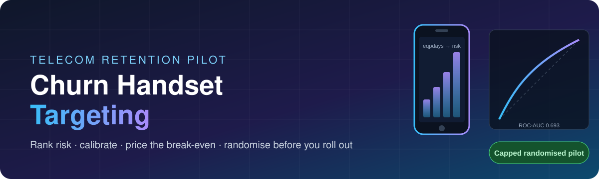
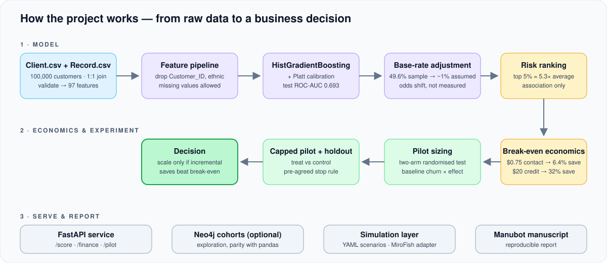
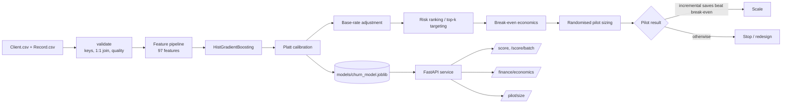

<p align="center">
  
</p>

<p align="center">
  <strong>A measurement-first telecom retention pilot — from churn modelling to a business decision.</strong>
</p>

<p align="center">
  <a href="https://github.com/sunilnarayan419-ui/churn-handset-targeting/actions/workflows/ci.yml"></a>
  <a href="https://github.com/sunilnarayan419-ui/churn-handset-targeting/actions/workflows/docs.yml"></a>
  <a href="https://github.com/sunilnarayan419-ui/churn-handset-targeting"></a>
  <a href="https://github.com/sunilnarayan419-ui/churn-handset-targeting/network/members"></a>
  <a href="LICENSE"></a>
</p>

<p align="center">
  
  
  
  
  
  
  
</p>

<p align="center">
  <a href="#-what-is-this">What is this</a> ·
  <a href="#-headline-findings">Findings</a> ·
  <a href="#-how-it-works">How it works</a> ·
  <a href="#-repository-structure">Structure</a> ·
  <a href="#-quick-start">Quick start</a> ·
  <a href="#-api-endpoints">API</a> ·
  <a href="#-limitations-and-responsible-use">Limitations</a>
</p>

---

## 🎯 What is this?

A telecom operator (anonymised as **Company A**) wants to reduce customer churn by targeting customers whose **handsets are ageing**. This repository answers the question in the order a careful analyst would:

1. **Who is at risk?** Rank customers with a calibrated gradient-boosting model.
2. **Is the ranking trustworthy on the real base rate?** Adjust probabilities from the enriched sample (~49.6% churn) to a realistic ~1% monthly rate.
3. **What would an intervention have to achieve to pay for itself?** Compute transparent break-even save rates.
4. **How do we find out whether it works?** Size a two-arm randomised pilot with a holdout and a stop rule.
5. **How do we ship it responsibly?** Serve scoring, economics and pilot sizing through a FastAPI service, with an optional Neo4j cohort layer and a reproducible Manubot manuscript.

Built from the **GCI World 2026 final assignment**. Author: **Sunil Mandloi**.

> **Decision in one sentence:** use the model to design a capped, randomised retention experiment — not to justify an immediate rollout. Predictive association does not establish that contacting a customer will prevent churn.

<p align="center">
  
</p>

## 📊 Headline findings

These are the reported results reproduced by this repository from the supplied assignment data. They cannot be independently regenerated without the original files, which are intentionally not distributed.

| Result | Reported finding | Interpretation |
|---|---:|---|
| Customers analysed | 100,000 | Enriched assignment sample; 97 model features after exclusions |
| Handset-age association | 39.5% churn at `eqpdays <= 300`; 59.3% at `301–400` | Association in this sample, not a causal effect |
| Model | `HistGradientBoostingClassifier` with Platt calibration | Scikit-learn pipeline; `Customer_ID` and `ethnic` excluded |
| Test ROC-AUC | 0.693 (reported bootstrap 95% CI 0.687–0.701) | Moderate ranking discrimination; 0.500 is chance ranking |
| Targeting | Top 5% reported as 5.3× as likely to churn as average under a 1% base-rate assumption | Base-rate adjustment is an assumption, not a measured Company A rate |
| Economics | $0.75 contact requires a reported 6.4% incremental save rate to break even; $20 credit requires 32% | Depends on margin, retention horizon, response and cost assumptions |
| Recommendation | Capped randomised pilot with a stop rule | Estimate incremental impact with a holdout before scaling |

The training command prints its own test metrics. For intended use, limitations, calibration, subgroup results and monitoring, read the [model card](docs/MODEL_CARD.md). For provenance and handling, read the [data card](docs/DATA_CARD.md).

## 🧠 How it works

### System flow



### Technical notes

**Model.** A scikit-learn pipeline around `HistGradientBoostingClassifier`, which handles missing values natively — which is why the API accepts sparse customer records (missing features are permitted and counted). `Customer_ID` and `ethnic` are excluded before fitting, leaving 97 model features.

**Calibration.** Raw scores are Platt-calibrated, so the first probability returned by `/score` is on the *enriched-sample* scale (~49.6% churn).

**Base-rate adjustment.** The deployment population is assumed to churn at roughly 1% per month, not ~50%. The second probability returned by `/score` is odds-adjusted to the requested base rate, i.e. the usual prior-shift correction:

```text
odds_adjusted = odds_calibrated × [ π_target / (1 − π_target) ] / [ π_sample / (1 − π_sample) ]
```

This is an assumption about the target population, not a measured Company A rate.

**Break-even economics.** For `n` treated customers, churn probability `p`, incremental save rate `s`, monthly revenue `r`, margin `m`, retention horizon `T` months and contact cost `c`:

```text
net_variable_benefit = n · p · s · r · m · T  −  n · c
break_even_save_rate = c / ( p · r · m · T )
```

Worked check (matches the API example below): `n=1000, p=0.05, s=0.10, r=50, m=0.40, T=12, c=0.50` → saves = 5, value per save = 240, benefit = 1,200, cost = 500, **net = 700**.

**Pilot sizing.** `/pilot/size` returns the sample size for a two-arm randomised test given a baseline churn probability and a relative effect. Only a randomised holdout — not the model — can estimate incremental retention impact.

**Cohort analytics.** The optional Neo4j layer supports cohort exploration, not better prediction: the supplied data contain no customer-to-customer relationships, and integration tests assert parity with pandas.

## 🗂 Repository structure

```text
churn-handset-targeting/
├── .github/
│   └── workflows/            CI, Neo4j integration, Docker and manuscript workflows
├── build/                    Manubot build script (build.sh) and manuscript.css — source files
├── configs/
│   └── simulation/           YAML retention scenarios (baseline, nudge, credit)
├── content/                  Manuscript sections, metadata, references and figures
├── data/                     Data instructions; raw assignment CSVs are NOT committed
│   └── raw/                  Client.csv, Record.csv go here (git-ignored)
├── docs/
│   ├── assets/               README graphics (banner, pipeline)
│   ├── ARCHITECTURE.md       Data flow
│   ├── API_REFERENCE.md      Request/response contracts and status codes
│   ├── DATA_CARD.md          Provenance and handling
│   ├── MODEL_CARD.md         Intended use, calibration, subgroups, monitoring
│   ├── GRAPH_MODEL.md        Neo4j cohort schema
│   ├── REPOSITORY_GUIDE.md   Module and test responsibilities
│   ├── DEVELOPMENT_WORKFLOW.md
│   ├── TESTING.md            Test interpretation and pre-push checklist
│   └── TRAINING_AND_EVALUATION.md
├── models/                   Model-artifact directory; generated artifacts not committed
├── notebooks/                Assignment analysis notebook and notes
├── reports/                  Reported/generated results, notebook outputs, PDF/PPTX
│   └── simulation/           Experiment manifests and scenario comparison reports
├── scripts/                  Training/API helpers, report and manuscript utilities
├── src/churn_targeting/
│   ├── api/                  FastAPI app and Pydantic request/response schemas
│   ├── simulation/           Scenario config, runner, evaluation, provenance, MiroFish adapter
│   └── …                     Data, features, modeling, calibration, finance, analytics
├── tests/                    Unit, synthetic-data, API, artifact, simulation and optional Neo4j tests
├── .env.example              Safe environment-variable template
├── CONTRIBUTING.md
├── Dockerfile                Container image for the API
├── docker-compose.yml        Optional Neo4j + API stack
├── LICENSE                   MIT
├── Makefile                  Common commands for Unix-like shells
└── pyproject.toml            Package metadata, extras, CLI, pytest and Ruff configuration
```

See the [Repository guide](docs/REPOSITORY_GUIDE.md) for module/test responsibilities, [Architecture](docs/ARCHITECTURE.md) for data flow, and [Development workflow](docs/DEVELOPMENT_WORKFLOW.md) for common fixes.

### Tech stack

| Layer | Tooling |
|---|---|
| Modelling | Python 3.10–3.12, scikit-learn (`HistGradientBoostingClassifier`, Platt calibration), pandas |
| Service | FastAPI, Pydantic schemas, optional `X-API-Key` auth |
| Graph (optional) | Neo4j via Docker Compose |
| Simulation (experimental) | YAML scenarios, MiroFish client/adapter |
| Quality | pytest (+ coverage), Ruff, `pip check`, `compileall`, GitHub Actions CI |
| Research output | Manubot manuscript, notebooks, PDF/PPTX reports |
| Packaging | `pyproject.toml` extras: `api`, `graph`, `dev`, `docs`, `notebook` |

## 🚀 Quick start

### Windows PowerShell (VS Code)

Run from the repository root. Python 3.12 is recommended locally; CI tests Python 3.10–3.12.

```powershell
py -3.12 -m venv .venv
.\.venv\Scripts\Activate.ps1
python -m pip install --upgrade pip
python -m pip install -e ".[api,graph,dev,docs,notebook]"

# Put authorised assignment files in data\raw\; never commit them.
Test-Path .\data\raw\Client.csv
Test-Path .\data\raw\Record.csv

churn-targeting validate
churn-targeting train
churn-targeting serve
```

If PowerShell blocks activation, run `Set-ExecutionPolicy -Scope Process -ExecutionPolicy Bypass` in that terminal and activate again. If port 8000 is occupied, reuse the existing server or run `churn-targeting serve --port 8001`.

### macOS / Linux

```bash
python3 -m venv .venv
source .venv/bin/activate
python -m pip install --upgrade pip
python -m pip install -e ".[api,graph,dev,docs,notebook]"

# Put authorised Client.csv and Record.csv in data/raw/; never commit them.
churn-targeting validate
churn-targeting train
churn-targeting serve
```

Open <http://127.0.0.1:8000/docs> for interactive API documentation.

### CLI commands

| Command | Purpose | Requires original data? |
|---|---|---:|
| `churn-targeting validate` | Checks files, keys, 1:1 join and data quality | Yes |
| `churn-targeting train` | Fits, calibrates, evaluates and saves model bundle + metadata JSON | Yes |
| `churn-targeting serve` | Starts FastAPI and loads `MODEL_PATH` at startup if present | No to start; yes for scoring |
| `churn-targeting graph-load --reset` | Loads cohort attributes into Neo4j; `--reset` clears graph first | Yes, plus Neo4j |
| `churn-targeting mirofish-preflight` | Read-only MiroFish project check | No, plus MiroFish |
| `python scripts/export_results.py` | Recomputes analysis/manuscript results from source data | Yes |
| `python scripts/check_manuscript.py` | Checks manuscript variables | `build/variables.json` required |

Training normally writes `models/churn_model.joblib` and `models/churn_model.json`. The `.joblib` file is pickle-based: **only load files you trained or trust.** Raw data and model artifacts are git-ignored by design. For a guided Windows run, execute the following from PowerShell after the environment is activated and the source files are present; details are in [Training and evaluation](docs/TRAINING_AND_EVALUATION.md).

```powershell
.\scripts\train_and_verify.ps1
```

### Docker

```bash
docker compose up -d neo4j     # optional graph database
docker build -t churn-targeting .
```

## 🔌 API endpoints

| Method + path | Purpose | Model required? |
|---|---|---:|
| `GET /health` | Liveness plus model and graph status; always open | No |
| `GET /model` | Model metadata and test metrics | Yes |
| `POST /score` | Score one customer | Yes |
| `POST /score/batch` | Score 1–5,000 customers | Yes |
| `POST /finance/economics` | Wave economics and break-even save rate | No |
| `POST /pilot/size` | Two-arm randomised pilot sample size | No |
| `GET /cohorts/{dimension}` | Cohort analytics via Neo4j or injected pandas frame | Data/store required |

If `API_KEY` is set, send it as `X-API-Key` to every endpoint except `/health`.

### Score a customer (PowerShell)

```powershell
$body = @{
  customer = @{
    eqpdays = 350
    months  = 14
    area    = "NEW YORK CITY AREA"
  }
} | ConvertTo-Json -Depth 5

Invoke-RestMethod -Method Post `
  -Uri "http://127.0.0.1:8000/score" `
  -ContentType "application/json" `
  -Body $body
```

Missing features are permitted and counted; unknown columns are ignored. The calibrated probability is on the enriched sample scale; the second probability is odds-adjusted to the requested base rate. Sparse input may produce less reliable scores. See the [API reference](docs/API_REFERENCE.md) for request/response contracts and status codes.

### Economics example

```powershell
$body = @{
  n_treated       = 1000
  churn_prob      = 0.05
  avg_monthly_rev = 50
  save_rate       = 0.10
  margin          = 0.40
  months          = 12
  contact_cost    = 0.50
} | ConvertTo-Json

Invoke-RestMethod -Method Post `
  -Uri "http://127.0.0.1:8000/finance/economics" `
  -ContentType "application/json" `
  -Body $body
```

With these inputs, `net_variable_benefit` should be approximately `700`. This checks arithmetic only; it does not validate business assumptions.

### Pilot sizing example

```powershell
$body = @{ baseline_churn_prob = 0.10; relative_effect = 0.20 } | ConvertTo-Json

Invoke-RestMethod -Method Post `
  -Uri "http://127.0.0.1:8000/pilot/size" `
  -ContentType "application/json" `
  -Body $body
```

## 🧪 Simulation experiments and MiroFish integration

The simulation layer adds a scenario-driven framework for comparing retention strategies, recording experiment provenance, evaluating outcomes and generating reports. It is an **experimental decision-support layer**; its scenario assumptions are illustrative and must not be presented as measured causal effects.

### Retention scenarios

The YAML scenarios are stored in `configs/simulation/`:

| Scenario | Illustrative intervention cost per target | Assumed save rate | Assumed value per save | Population |
|---|---:|---:|---:|---:|
| `retention_baseline.yaml` | $0 | 0% | $30 | 1,000 |
| `personalized_nudge.yaml` | $0.75 | 5% | $30 | 1,000 |
| `retention_credit.yaml` | $20 | 15% | $30 | 1,000 |

These values are configuration assumptions for comparing scenarios, not evidence that an intervention causes the specified save rate. Validate assumptions with a properly designed randomised pilot before making rollout or budget decisions.

### Integration components

| Module (`src/churn_targeting/simulation/`) | Responsibility |
|---|---|
| `config.py` | Loads and validates scenario configuration |
| `adapter.py` | Simulation adapter interface |
| `mirofish_adapter.py` | Connects the experiment layer to MiroFish |
| `mirofish_client.py` | MiroFish API client |
| `mirofish_health.py` | MiroFish service health checks |
| `runner.py` | Coordinates execution |
| `experiment.py` | Experiment inputs and provenance |
| `evaluation.py`, `provenance.py`, `reporting.py` | Evaluation, reproducibility metadata, scenario comparison reports |
| `schemas.py` | Structured simulation data |
| `cli.py`, `mirofish_cli.py` | Command-line interfaces |

Related tests: `tests/test_simulation_*.py` and `tests/test_mirofish_*.py`.

### MiroFish safety and preflight

The preflight command performs a **read-only** project-list check. It does not create a project, build a graph, call an LLM or start a simulation. From the repository root with the environment activated:

```powershell
churn-targeting mirofish-preflight --project-id "<MIROFISH_PROJECT_ID>" --base-url "http://localhost:5001"
```

Review the returned project requirement and confirm that it matches the selected telecom retention scenario. The preflight keyword checks are heuristic and do not establish semantic compatibility; manually verify the project's source document, ontology and requirements. If the project is unrelated, unverified or incompatible, do not proceed.

The `mirofish-run` command requires explicit execution and scenario-match confirmation flags (`--allow-remote-execution` and `--confirm-project-requirement-matches-scenario`). These flags are safeguards, not proof that a project is appropriate. Do not run simulations against the existing fictional agricultural test project. Keep remote execution disabled until a dedicated, verified telecom/churn project and its data have been prepared and reviewed.

### Reproducibility and reports

Simulation outputs may include an experiment manifest and scenario comparison report under `reports/simulation/`. Review generated reports before sharing or committing them, and do not treat assumed save rates or simulated outcomes as validated real-world treatment effects. Keep secrets, raw customer data and local environment files out of version control.

## ✅ Testing and quality gates

The regular suite uses synthetic fixtures and does not need the original assignment CSVs.

```powershell
python -m pip check
python -m ruff check .
python -m compileall -q src tests
python -m pytest -m "not integration" -v --cov=churn_targeting --cov-report=term-missing
```

Neo4j integration tests require a running/configured database: `python -m pytest -m integration -v`.

After training and starting the API, run the live endpoint smoke test from a second PowerShell terminal:

```powershell
.\scripts\smoke_test_api.ps1
```

See the [Testing guide](docs/TESTING.md) for test interpretation and the pre-push checklist. Green synthetic tests do not prove the real-data pipeline, predictive performance, or production deployment are valid.

## 🕸 Optional Neo4j cohort layer

Neo4j supports cohort exploration, not better prediction: the supplied data contain no customer-to-customer relationships, and integration tests assert parity with pandas.

1. Copy `.env.example` to `.env` and set a strong local `NEO4J_PASSWORD` (at least 8 characters for Compose).
2. Start Neo4j with `docker compose up -d neo4j`.
3. Export `NEO4J_URI`, `NEO4J_USER`, `NEO4J_PASSWORD`, and `NEO4J_DATABASE` into the CLI environment.
4. Run `churn-targeting graph-load --reset` only if you intend to clear and reload the graph.

The application reads environment variables; it does not automatically parse `.env` unless another tool loads it. Never commit `.env`. See [Graph model](docs/GRAPH_MODEL.md) and [Development workflow](docs/DEVELOPMENT_WORKFLOW.md).

## 📄 Manuscript and reports

- `content/` contains the Manubot manuscript source, references, metadata and figures.
- `build/build.sh` builds the manuscript; output is written under `output/`.
- `python scripts/export_results.py --data-dir data/raw --out reports/results.json` recomputes analysis variables from raw data (typically 1–2 minutes on one CPU core).
- `scripts/export_manuscript_variables.py` exports manuscript variables; `scripts/check_manuscript.py` fails if a manuscript variable is undefined.
- `reports/` contains supplied report artefacts and analysis summaries; regenerate from raw data when available rather than treating reports as the source of truth.

## 🔒 Git and data safety

Before committing, review every staged path. Commit source code, tests, documentation, manuscript source, configuration and reviewed report artefacts. Do **not** commit raw assignment files, customer extracts/scored lists, `.env`, API keys, database passwords, tokens, `.venv`, caches, generated build variables or unnecessary model binaries.

The `.gitignore` excludes raw data and model artifacts while preserving `data/README.md`, `data/raw/.gitkeep`, and `models/.gitkeep`. A `data/`, `models/` or `build/` entry in `git status` is not automatically a problem: inspect the actual files. `build/build.sh` and `build/manuscript.css` are source files and should remain versioned.

Code is MIT-licensed (see [LICENSE](LICENSE)); this does not grant rights to redistribute assignment data. See the [Data card](docs/DATA_CARD.md) and [Contributing](CONTRIBUTING.md).

## ⚠️ Limitations and responsible use

- The sample is enriched (approximately 49.6% churn), unlike the assumed roughly 1% monthly churn. Base-rate adjustment depends on the actual deployment population and outcome window.
- No timestamps are available for time-based validation; the target describes churn 31–60 days after observation.
- Model outputs are associations/risk rankings, not treatment effects. Only a properly randomised pilot estimates incremental retention impact.
- Demographic and socioeconomic variables may act as proxies. Excluding `ethnic` does not establish fairness.
- Do not use this model for credit, eligibility, pricing discrimination, denial of service, or other consequential individual decisions.
- Before operational use, validate on representative current data, audit subgroup performance and calibration, document lawful basis/consent and opt-out handling, and set monitoring and rollback rules.

---

<p align="center">
  Built by <strong>Sunil Mandloi</strong> · MIT licensed · If this helped, consider giving it a ⭐
</p>
