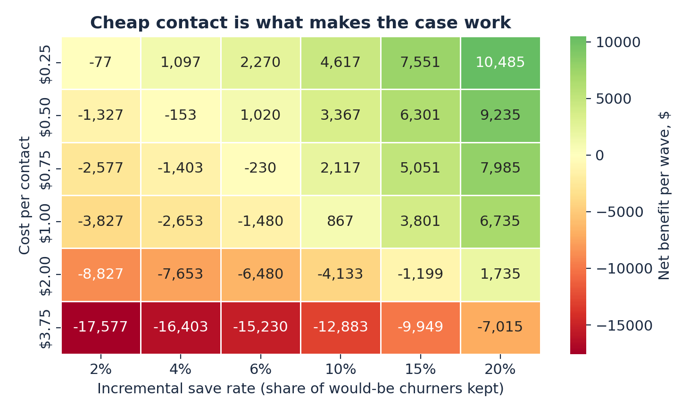

## Business case

We evaluate a low-cost message (a handset-upgrade or plan-review nudge) sent to the top 5% of customers each month, for a customer book of {{ results.fin.book }}. In the top 5% slice the average real-world churn probability is {{ results.fin.churn_prob_top5 }} and average monthly revenue is {{ results.fin.rev_top5 }} (US dollars assumed), so a retained customer is worth {{ results.fin.value_per_save }} in the base case.

**Break-even.** A {{ results.fin.contact_cost }} nudge must keep at least {{ results.fin.break_nudge }} of would-be churners to cover its own cost; a {{ results.fin.incentive }} credit accepted by {{ results.fin.accept_rate }} of contacts would need {{ results.fin.break_incent }}, which is implausible, so we do not recommend blanket incentives.

| Scenario (top 5%) | Save rate | Saved per year | Gross benefit | Contact cost | Net after fixed cost | ROI |
|:--|--:|--:|--:|--:|--:|--:|
| Conservative | {{ results.fin.scen.top5_conservative.save_rate }} | {{ results.fin.scen.top5_conservative.saved }} | {{ results.fin.scen.top5_conservative.gross }} | {{ results.fin.scen.top5_conservative.var_cost }} | {{ results.fin.scen.top5_conservative.net }} | {{ results.fin.scen.top5_conservative.roi }} |
| Base | {{ results.fin.scen.top5_base.save_rate }} | {{ results.fin.scen.top5_base.saved }} | {{ results.fin.scen.top5_base.gross }} | {{ results.fin.scen.top5_base.var_cost }} | {{ results.fin.scen.top5_base.net }} | {{ results.fin.scen.top5_base.roi }} |
| Upside | {{ results.fin.scen.top5_upside.save_rate }} | {{ results.fin.scen.top5_upside.saved }} | {{ results.fin.scen.top5_upside.gross }} | {{ results.fin.scen.top5_upside.var_cost }} | {{ results.fin.scen.top5_upside.net }} | {{ results.fin.scen.top5_upside.roi }} |

Table: Annual economics per {{ results.fin.book }} customers (12 monthly waves). Churn rate, margin, months retained and contact cost vary by scenario (conservative: 0.86%, 30%, 6 months, $1.00; base: 0.99%, 40%, 12 months, $0.75; upside: 1.04%, 50%, 12 months, $0.50). All are assumptions or scenarios.

Only the upside scenario covers the fixed cost on this book size (break-even book of about {{ results.fin.breakeven_book_top5_upside }} customers); the base case is slightly below break-even even before fixed costs (Figure 3). The case therefore depends on three things the model cannot supply: a very cheap contact channel, a sufficiently large customer base, and a measured save rate.

{width=75%}

**Pilot.** Because only {{ results.fin.churn_prob_top5 }} of the contacted slice would churn in a month, a randomised hold-out test needs {{ results.fin.n20 }} customers per arm to detect a 20% relative reduction in churn, {{ results.fin.n10 }} for a 10% reduction and {{ results.fin.n30 }} for 30% (80% power, 5% significance). Contacting the treated arm at the assumed cost would cost about {{ results.fin.pilot_cost }} for the 20% case. A pilot of that size is decisive only if the effect is large; smaller effects require pooling several monthly waves or a larger footprint. We recommend scaling only if the measured save rate reaches the break-even rate at the assumed contact cost, and stopping otherwise.
