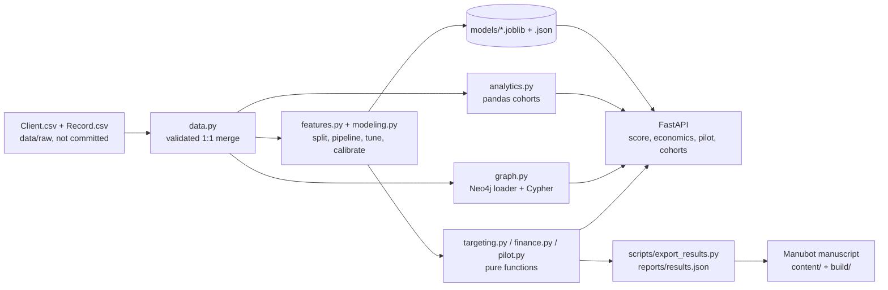

# Architecture

## Design decisions

- **Pure core, thin edges.** Targeting, finance and pilot sizing are plain functions with explicit arguments, so they are testable without a model, a database or a web server. The API only validates input and calls them.
- **One definition of a segment.** `bands.py` defines every cohort once; the pandas analytics and the Neo4j loader both use it, and an integration test proves they agree.
- **Splits before fitting.** All encoding and imputation lives inside the scikit-learn pipeline; the calibrator is fitted on out-of-fold training predictions only.
- **Numbers are never typed into the paper.** The manuscript pulls every figure from `reports/results.json`, which `scripts/export_results.py` recomputes from the raw data. `scripts/check_manuscript.py` fails the build on any undefined variable.
- **Optional heavy dependencies.** FastAPI and Neo4j are extras; the core package needs only numpy, pandas, scikit-learn and joblib. The graph store accepts an injected driver, so its logic is unit-tested with a fake.
- **Safe by default.** Cypher labels and relationship types come from a fixed whitelist (never from request data), data is passed as query parameters, the API key comparison is constant-time, the container runs as a non-root user, and secrets come from the environment.
