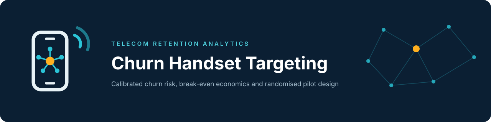

Churn Handset Targeting
=======================

**Churn Handset Targeting** is a Python package, REST service and documentation set for a
measurement-first telecom retention pilot. It ranks customers by churn risk with a calibrated
gradient-boosting model, rescales probabilities to an assumed real-world base rate, computes
break-even retention economics, and sizes a two-arm randomised pilot that is needed to find out
whether contacting customers actually reduces churn.

.. note::

   The model measures *association and ranking*, not the causal effect of a retention offer.
   Only a randomised hold-out pilot can estimate incremental retention. See
   :doc:`scientific-reproducibility/limitations`.

Implementation status
---------------------

.. list-table::
   :header-rows: 1
   :widths: 28 14 58

   * - Component
     - Status
     - Basis
   * - Data validation, feature pipeline, training, calibration, scoring
     - Implemented
     - ``src/churn_targeting/{data,features,modeling,calibration}.py``; unit tests on synthetic data.
   * - Targeting statistics, break-even economics, pilot sizing, cohort analytics
     - Implemented
     - Pure functions in ``targeting.py``, ``finance.py``, ``pilot.py``, ``analytics.py``.
   * - FastAPI service (7 routes, optional ``X-API-Key``)
     - Implemented
     - ``api/main.py`` and ``api/schemas.py``; see :doc:`api/index`.
   * - Neo4j cohort layer
     - Implemented, optional
     - ``graph.py``; needs the ``graph`` extra and a database; parity checked by integration tests.
   * - Assumption-based scenario comparison and provenance manifests
     - Implemented
     - ``simulation/{experiment,evaluation,reporting,provenance}.py``; deterministic, no simulator.
   * - MiroFish client, adapter, health check, ``mirofish-run``
     - Experimental
     - Gated integration code; no end-to-end run against a telecom-appropriate project is recorded
       in the repository. See :doc:`simulation/mirofish-integration`.
   * - Randomised retention pilot
     - Proposed
     - Sample-size calculation is implemented; the pilot itself has not been run.
   * - Causal estimate of retention uplift
     - Not available
     - Requires pilot data that do not exist in this repository.

.. toctree::
   :hidden:
   :caption: Getting started

   getting-started/overview
   getting-started/problem-statement
   getting-started/installation
   getting-started/environment-setup
   getting-started/quickstart

.. toctree::
   :hidden:
   :caption: Architecture

   architecture/system-architecture
   architecture/application-architecture
   architecture/data-flow
   architecture/model-pipeline
   architecture/technology-stack

.. toctree::
   :hidden:
   :caption: Data science

   data-science/data-provenance
   data-science/data-validation
   data-science/feature-engineering
   data-science/model-development
   data-science/calibration
   data-science/evaluation

.. toctree::
   :hidden:
   :caption: API

   api/index

.. toctree::
   :hidden:
   :caption: Business methodology

   business-methodology/customer-targeting
   business-methodology/retention-economics
   business-methodology/break-even-analysis
   business-methodology/pilot-design

.. toctree::
   :hidden:
   :caption: Graph analytics

   graph-analytics/overview
   graph-analytics/graph-schema
   graph-analytics/neo4j-integration

.. toctree::
   :hidden:
   :caption: Simulation (experimental)

   simulation/overview
   simulation/experimental-design
   simulation/evaluation
   simulation/mirofish-integration

.. toctree::
   :hidden:
   :caption: Deployment

   deployment/docker
   deployment/configuration
   deployment/security
   deployment/operational-considerations

.. toctree::
   :hidden:
   :caption: Development

   development/repository-guide
   development/development-workflow
   development/testing
   development/contributing
   development/troubleshooting
   development/changelog

.. toctree::
   :hidden:
   :caption: Scientific reproducibility

   scientific-reproducibility/model-card
   scientific-reproducibility/data-card
   scientific-reproducibility/limitations
   scientific-reproducibility/manuscript-pipeline
   scientific-reproducibility/references
