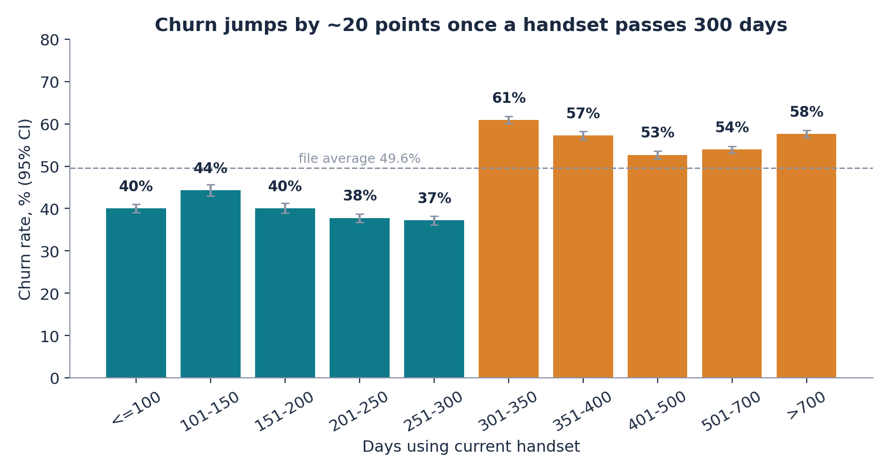
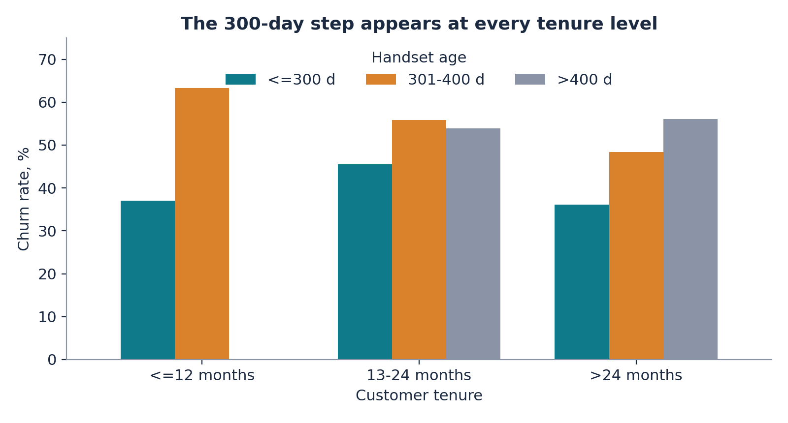

---
title: 'Handset-age churn targeting: a measurement-first retention pilot for a telecom operator'
keywords:
- customer churn
- telecommunications
- retention economics
- gradient boosting
- probability calibration
- randomised pilot
lang: en-US
date-meta: '2026-10-16'
author-meta:
- SunilMandloi
header-includes: |
  <!--
  Manubot generated metadata rendered from header-includes-template.html.
  Suggest improvements at https://github.com/manubot/manubot/blob/main/manubot/process/header-includes-template.html
  -->
  <meta name="dc.format" content="text/html" />
  <meta property="og:type" content="article" />
  <meta name="dc.title" content="Handset-age churn targeting: a measurement-first retention pilot for a telecom operator" />
  <meta name="citation_title" content="Handset-age churn targeting: a measurement-first retention pilot for a telecom operator" />
  <meta property="og:title" content="Handset-age churn targeting: a measurement-first retention pilot for a telecom operator" />
  <meta property="twitter:title" content="Handset-age churn targeting: a measurement-first retention pilot for a telecom operator" />
  <meta name="dc.date" content="2026-10-16" />
  <meta name="citation_publication_date" content="2026-10-16" />
  <meta property="article:published_time" content="2026-10-16" />
  <meta name="dc.modified" content="2026-10-16T13:03:27+00:00" />
  <meta property="article:modified_time" content="2026-10-16T13:03:27+00:00" />
  <meta name="dc.language" content="en-US" />
  <meta name="citation_language" content="en-US" />
  <meta name="dc.relation.ispartof" content="Manubot" />
  <meta name="dc.publisher" content="Manubot" />
  <meta name="citation_journal_title" content="Manubot" />
  <meta name="citation_technical_report_institution" content="Manubot" />
  <meta name="citation_author" content="SunilMandloi" />
  <link rel="canonical" href="https://sunilnarayan419-ui.github.io/churn-handset-targeting/" />
  <meta property="og:url" content="https://sunilnarayan419-ui.github.io/churn-handset-targeting/" />
  <meta property="twitter:url" content="https://sunilnarayan419-ui.github.io/churn-handset-targeting/" />
  <meta name="citation_fulltext_html_url" content="https://sunilnarayan419-ui.github.io/churn-handset-targeting/" />
  <meta name="citation_pdf_url" content="https://sunilnarayan419-ui.github.io/churn-handset-targeting/manuscript.pdf" />
  <link rel="alternate" type="application/pdf" href="https://sunilnarayan419-ui.github.io/churn-handset-targeting/manuscript.pdf" />
  <link rel="alternate" type="text/html" href="https://sunilnarayan419-ui.github.io/churn-handset-targeting/v/af185ca70507d89d2f308a1695a72360141d4a02/" />
  <meta name="manubot_html_url_versioned" content="https://sunilnarayan419-ui.github.io/churn-handset-targeting/v/af185ca70507d89d2f308a1695a72360141d4a02/" />
  <meta name="manubot_pdf_url_versioned" content="https://sunilnarayan419-ui.github.io/churn-handset-targeting/v/af185ca70507d89d2f308a1695a72360141d4a02/manuscript.pdf" />
  <meta property="og:type" content="article" />
  <meta property="twitter:card" content="summary_large_image" />
  <link rel="icon" type="image/png" sizes="192x192" href="https://manubot.org/favicon-192x192.png" />
  <link rel="mask-icon" href="https://manubot.org/safari-pinned-tab.svg" color="#ad1457" />
  <meta name="theme-color" content="#ad1457" />
  <!-- end Manubot generated metadata -->
bibliography:
- content/manual-references.json
manubot-output-bibliography: output/references.json
manubot-output-citekeys: output/citations.tsv
manubot-requests-cache-path: ci/cache/requests-cache
manubot-clear-requests-cache: false
...

# 

**SunilMandloi**

*Technical report. Built October 16, 2026.*

## Abstract

**Background.** Large US wireless carriers lose roughly one percent of postpaid customers a month [@tag:tmobile-q2-2026; @tag:verizon-q2-2026-cxdive; @tag:att-q2-2026-thedesk]. A retention programme must therefore find the few customers who are about to leave and contact them cheaply.

**Data and methods.** We analyse 100,000 anonymised customers with 97 usage, billing and handset fields; 49.6% churned within 31 to 60 days of the observation date, so the sample is heavily enriched with churners. We fit a gradient-boosting classifier on a stratified 80/20 split, calibrate its probabilities, and rescale them to a realistic one-percent base rate. A transparent break-even model and a sample-size calculation for a randomised hold-out pilot follow from the model.

**Results.** Churn is 39.5% for customers whose handset is at most 300 days old and 59.3% for 301 to 400 days, a step that appears in every tenure group. The model reaches a test ROC-AUC of 0.693 (95% bootstrap interval 0.687 to 0.701) against 0.500 for a no-skill baseline. At a 1% base rate the top 5% of customers by risk are 5.3x as likely to churn as average, but about 95% of them would have stayed anyway.

**Conclusions.** A $0.75 message to the top 5% pays for itself only if it keeps at least 6.4% of would-be churners; a $20 credit would need 32%. The model measures risk, not response, so we recommend a capped randomised pilot and a stop rule rather than a rollout. All numbers are regenerated from the supplied data by the accompanying code.

## Introduction

Customer retention is a first-order commercial lever for wireless carriers. In the second quarter of 2026, T-Mobile reported postpaid account churn of 0.99% [@tag:tmobile-q2-2026], Verizon reported overall churn of 0.92% (0.84% for consumer postpaid phones) [@tag:verizon-q2-2026-cxdive; @tag:verizon-q2-2026-nasdaq], and AT&T reported postpaid phone churn of 0.86% [@tag:att-q2-2026-thedesk; @tag:att-q2-2026-phonearena]. The three operators define churn differently (accounts versus phone lines), so these figures are an order-of-magnitude anchor rather than a like-for-like benchmark. At a constant 0.99% a month, about 11.3% of customers would leave within a year (author calculation).

At that base rate a campaign that contacts customers at random wastes almost all of its budget. The practical question for an operator is therefore twofold: *whom* to contact before they leave, and *how much* each contact may cost.

This report answers both questions for an anonymised operator, "Company A", using only the supplied customer files. It makes three contributions. First, it documents a sharp, robust relationship between handset age and churn. Second, it shows how to turn a model trained on an enriched sample into base-rate-adjusted precision and break-even economics. Third, it argues, with explicit sample-size arithmetic, that the decisive quantity (the incremental effect of contact) cannot be learned from the model and must be measured in a randomised pilot.

## Data

The two supplied tables describe the same 100,000 customers. `Client.csv` holds account and equipment characteristics and `Record.csv` holds usage, billing, call-quality fields and the churn label. `Customer_ID` is present, non-null and unique in both files and the sets match exactly, so a validated one-to-one merge yields 100,000 rows with no multiplication or loss.

**Target.** `churn` equals 1 if the customer left 31 to 60 days after the observation date. The task is binary classification. Churn is 49.6% in the file, far above market rates, so the sample is enriched with churners; rankings and relative lift transfer to a realistic population, but raw precision, accuracy and counts do not.

**Quality.** 43 of 100 columns contain missing values, concentrated in household demographics (up to 49.4% for `numbcars`). Usage and billing fields are almost complete. Missing values are imputed or handled natively inside the modelling pipeline and are never filled using test data.

**Leakage review.** No single variable separates churners well (the strongest stand-alone ROC-AUC is 0.574), and the data dictionary contains no cancellation, port-out or retention-offer fields. The data carry no timestamps, so we cannot prove that every column was recorded before the outcome window and we cannot run a time-based validation. We treat both as limitations.

**Fairness.** The `ethnic` field is excluded from every model, because a protected characteristic must not be used to decide whom to contact. Other demographic fields (for example income and marital status) remain and should be reviewed for proxy effects before deployment.

**Currency and market.** The data state no currency; we assume US dollars, consistent with the handset prices and the US-style regional labels. This is an assumption, not a finding.

## Methods

**Split and pipeline.** We split the customers 80/20, stratified on churn, with a fixed seed. All encoding and imputation steps live inside a scikit-learn pipeline [@tag:scikit-learn] and are fitted on training data only. The test set is used once, to report final scores.

**Models.** We compared a dummy baseline (always predicts the training churn rate), regularised logistic regression, a random forest, and a histogram-based gradient-boosting classifier. Hyper-parameters were tuned by three-fold cross-validation on the training data, and the model was chosen by cross-validated ROC-AUC before the test set was examined. ROC-AUC is the principal metric because a capacity-limited campaign depends on how well customers are *ranked*; we also report precision-recall AUC, precision, recall, F1, accuracy and the Brier score.

**Calibration and base-rate shift.** Scores are calibrated by Platt scaling fitted on out-of-fold training predictions. Probabilities $p_s$ on the sample scale (base rate $\pi_s$) are rescaled to a realistic base rate $\pi$ through the odds:

$$\mathrm{logit}(p_\pi) = \mathrm{logit}(p_s) + \ln\frac{\pi}{1-\pi} - \ln\frac{\pi_s}{1-\pi_s}$$

The precision of a contacted slice at base rate $\pi$ follows from its true-positive rate (TPR) and false-positive rate (FPR) in the file:

$$\mathrm{precision}_\pi = \frac{\mathrm{TPR}\,\pi}{\mathrm{TPR}\,\pi + \mathrm{FPR}\,(1-\pi)}$$

We use $\pi$ = 0.99% per month, anchored on the carrier disclosures above. It is a labelled assumption, not Company A's measured rate.

**Retention economics.** Per monthly wave, contacting $N$ customers whose real-world churn probability is $p$ puts $Np$ would-be churners in play. If contact keeps a share $s$ of them (the *incremental* save rate), the gross benefit is $N p s V$ with $V$ = monthly revenue × contribution margin × months retained. The variable cost is $N(c + a I)$ for contact cost $c$, acceptance rate $a$ and incentive $I$. The wave breaks even at

$$s^{*} = \frac{c + aI}{p\,V}$$

Margin (40%), months retained (12), contact cost ($0.75), incentive ($20, accepted by 15%), save rate and a fixed programme cost of $60,000 per year are assumptions or scenarios, not measurements.

**Pilot size.** To detect a relative reduction $r$ in a churn probability $p_0$ with a two-sided test at level $\alpha$ and power $1-\beta$, each arm needs

$$n = \frac{\left(z_{1-\alpha/2}\sqrt{2\bar p(1-\bar p)} + z_{1-\beta}\sqrt{p_0(1-p_0)+p_1(1-p_1)}\right)^2}{(p_0-p_1)^2}$$

where $p_1 = p_0(1-r)$ and $\bar p = (p_0+p_1)/2$.

## Results

### Handset age marks a sharp step in churn

Churn is 39.5% among customers whose handset is at most 300 days old (n = 40,088) and 59.3% for 301 to 400 days (n = 20,866), a difference of about 20 percentage points (chi-square test, p < 0.001) (Figure 1). The step is not a tenure artefact: within customers of at most 12 months the rate moves from 37.0% to 63.3%, within 13 to 24 months from 45.5% to 55.8%, and beyond 24 months from 36.2% to 48.4% (Figure 2). Revenue, usage trend and care calls matter less: across their groups churn ranges only over 48.5% to 52.9%, 45.6% to 54.0% and 44.1% to 51.8% respectively (handset price: 41.0% to 57.5%). The 301 to 400 day cohort is 20.9% of customers but holds only 25.0% of churners, so the rule alone is not selective. These are associations, not evidence that handset age causes churn.

{width=85%}

{width=70%}

### Model performance

| Model | CV ROC-AUC | Test ROC-AUC | Test PR-AUC | Test accuracy |
|:--|--:|--:|--:|--:|
| Dummy baseline | 0.500 | 0.500 | 0.496 | 0.504 |
| Logistic regression | 0.641 | 0.644 | 0.630 | 0.607 |
| Random forest | 0.673 | 0.675 | 0.658 | 0.623 |
| **Gradient boosting (selected)** | 0.689 | **0.693** | 0.681 | 0.636 |

Table: Model comparison on the 20,000-customer test set. CV = three-fold cross-validation on training data.

The selected gradient-boosting model reaches a test ROC-AUC of 0.693 (95% bootstrap interval 0.687 to 0.701), precision 0.630, recall 0.645 and F1 0.638 at the 0.50 cut-off, and a Brier score of 0.2211 after calibration (0.2212 before). The packaged implementation in this repository reproduces the notebook's figures. Accuracy is not a useful headline because the file is almost balanced. The top risk decile churns at 78.3% against 19.9% in the bottom decile, a ratio of 3.9. Ranking is stronger for customers in their first year (ROC-AUC 0.749) than for 13 to 24 month customers (0.650) or beyond (0.682), and varies from 0.640 to 0.734 across areas.

### Targeting at a realistic base rate

| Contacted slice | Churn rate in file | Recall | Precision at 1% base rate | Lift at 1% base rate |
|:--|--:|--:|--:|--:|
| Model: top 5% | 84.6% | 9% | 5.3% | 5.3x |
| Model: top 10% | 78.3% | 16% | 3.6% | 3.6x |
| Model: top 20% | 73.3% | 30% | 2.7% | 2.7x |
| Rule: handset 301 to 400 days | 59.8% | 25% | 1.5% | 1.5x |

Table: Targeting performance. Precision and lift are rescaled with Bayes' rule to a 1% monthly base rate.

The model concentrates risk far better than the handset-age rule, but at a realistic base rate the large majority of contacted customers would have stayed anyway. Predictive importance is led by customer tenure and handset age, followed by the change in minutes of use and total minutes; this shows what the model uses, not what would change behaviour.

## Business case

We evaluate a low-cost message (a handset-upgrade or plan-review nudge) sent to the top 5% of customers each month, for a customer book of 100,000. In the top 5% slice the average real-world churn probability is 5.2% and average monthly revenue is $47 (US dollars assumed), so a retained customer is worth $224 in the base case.

**Break-even.** A $0.75 nudge must keep at least 6.4% of would-be churners to cover its own cost; a $20 credit accepted by 15% of contacts would need 32%, which is implausible, so we do not recommend blanket incentives.

| Scenario (top 5%) | Save rate | Saved per year | Gross benefit | Contact cost | Net after fixed cost | ROI |
|:--|--:|--:|--:|--:|--:|--:|
| Conservative | 3% | 83 | $6,931 | $60,000 | -$113,069 | -94% |
| Base | 6% | 189 | $42,246 | $45,000 | -$62,754 | -60% |
| Upside | 10% | 329 | $92,203 | $30,000 | $2,203 | 2% |

Table: Annual economics per 100,000 customers (12 monthly waves). Churn rate, margin, months retained and contact cost vary by scenario (conservative: 0.86%, 30%, 6 months, $1.00; base: 0.99%, 40%, 12 months, $0.75; upside: 1.04%, 50%, 12 months, $0.50). All are assumptions or scenarios.

Only the upside scenario covers the fixed cost on this book size (break-even book of about 96,459 customers); the base case is slightly below break-even even before fixed costs (Figure 3). The case therefore depends on three things the model cannot supply: a very cheap contact channel, a sufficiently large customer base, and a measured save rate.

{width=75%}

**Pilot.** Because only 5.2% of the contacted slice would churn in a month, a randomised hold-out test needs 6,420 customers per arm to detect a 20% relative reduction in churn, 27,033 for a 10% reduction and 2,702 for 30% (80% power, 5% significance). Contacting the treated arm at the assumed cost would cost about $4,815 for the 20% case. A pilot of that size is decisive only if the effect is large; smaller effects require pooling several monthly waves or a larger footprint. We recommend scaling only if the measured save rate reaches the break-even rate at the assumed contact cost, and stopping otherwise.

## Discussion

**What the evidence supports.** Handset age is a strong, robust marker of churn risk, and a calibrated gradient-boosting model ranks customers materially better than chance and than a simple age rule. At a realistic base rate, ranking quality supports prioritisation, not individual prediction.

**What it does not establish.** (1) *Association, not cause*: nothing here shows that upgrading a handset, or contacting a customer, reduces churn. (2) *Enriched sample*: the file's churn rate is about fifty times the market rate, so base-rate-adjusted figures depend on an assumed rate. (3) *No timestamps*: we cannot run a time-based validation or verify column timing. (4) *Moderate predictability*: a ROC-AUC near 0.69 is useful for ordering customers, not for forecasting any one of them. (5) *Assumed economics*: margin, costs, save rates and fixed cost are placeholders.

**Responsible use.** Contacting customers requires consent and opt-out handling; the protected `ethnic` field is excluded, but remaining demographic fields should be audited for proxy effects, and ranking quality should be monitored by tenure group because it differs across them. Model files are pickles and must only be loaded from trusted sources.

**Graph analytics.** The repository includes an optional Neo4j layer that stores customers and their segments as a graph for cohort exploration. The supplied data contain no customer-to-customer links, so this layer does not improve prediction; it would become valuable if household, referral or porting relationships were available.

**Future work.** Replace the placeholders with the operator's own churn rate, margins and costs; verify column timing and re-validate on a time-based split; run the randomised pilot; and, if treatment data become available, move from risk modelling to uplift modelling.

## Data and code availability {.page_break_before}

The customer files were supplied with a university assignment and are not redistributed. Place `Client.csv` and `Record.csv` in `data/raw/` to reproduce every number: `scripts/export_results.py` regenerates `reports/results.json` from the raw files, and `scripts/export_manuscript_variables.py` feeds those values into this manuscript. The repository also provides a typed-schema API, a Neo4j cohort layer, and an automated test suite.

## AI assistance

Generative AI was used while preparing the analysis and this report. ChatGPT conversation: <https://chatgpt.com/share/6acccf90-6cd0-83ec-84bf-165da7064fe2>. Claude (Anthropic) assisted with code, tests and drafting. The author is responsible for the content; every reported number is produced by the code in this repository.

## References {.page_break_before}

<!-- Manubot inserts the reference list here. -->

